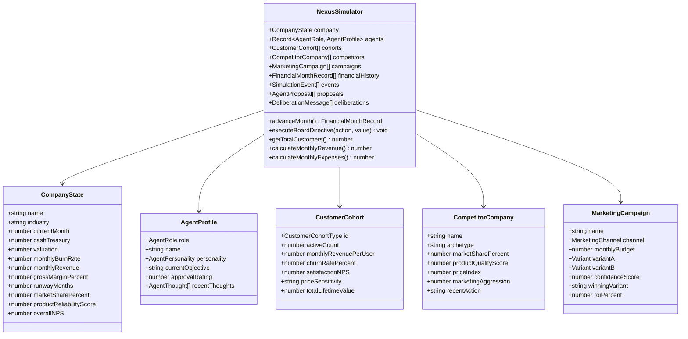

# 🏛️ NEXUS FACTORY — System Architecture Document

> 📌 **Purpose:** Detailed architectural specification for the NEXUS FACTORY Autonomous Business Simulator, specifying data structures, state machines, simulation physics, multi-agent cognitive loops, and UI rendering tiers.

---

## 📋 Architecture Properties

| Property | Value |
| :--- | :--- |
| **System Name** | NEXUS FACTORY Multi-Agent Enterprise Engine |
| **Execution Model** | Client-side deterministic discrete-event simulation |
| **State Machine** | Reactive state container (`NexusSimulator`) with event subscriptions |
| **Rendering Pipeline** | React 19 concurrent mode + optimized SVG path projection |
| **Styling Framework** | Tailwind CSS v4 with CSS variables design token layer |
| **Audio Engine** | Web Audio API oscillator synthesis (zero external audio assets) |

---

## 🏗️ Architectural Topology

---

## ⚙️ Mathematical Physics of the Simulation

### 1. Cohort Retention & Churn Dynamics
For each customer cohort $C$, monthly churn rate $\text{Churn}_t$ is computed dynamically:

$$\text{Churn}_t = \max\left(0.005, \, \text{BaseChurn} + \frac{100 - \text{Reliability}}{100} \times 0.4 + \frac{100 - \text{NPS}}{200} \times 0.3\right)$$

Where:
- $\text{BaseChurn}$ is the cohort's natural baseline churn.
- $\text{Reliability}$ is the platform uptime / QA rating ($0 \dots 100$).
- $\text{NPS}$ is the customer cohort Net Promoter Score ($-100 \dots +100$).

### 2. Marketing Attribution & A/B Statistical Confidence
Each campaign splits budget evenly between Control Variant A and Challenger Variant B:

$$\text{Conversions}_{A} = \text{Budget} \times 0.5 \times \text{CTR}_A \times \text{CVR}_A$$
$$\text{CAC}_A = \frac{\text{Budget} \times 0.5}{\max(1, \text{Conversions}_A)}$$

Statistical significance accumulates monthly based on sample size and variance differential:

$$\Delta_{\text{CAC}} = |\text{CAC}_A - \text{CAC}_B|$$
$$\text{Confidence}_{t} = \min\left(99\%, \, \text{Confidence}_{t-1} + 1.5\% \times \frac{\text{Impressions}}{10,000}\right)$$

When confidence exceeds $95\%$, the superior variant is formally declared as the winner, prompting the CMO to reallocate channel capital.

### 3. P&L & Balance Sheet Cashflow
Every monthly tick generates a full Income Statement:

$$\text{Revenue} = \sum_{c \in \text{Cohorts}} \left(\text{Count}_c \times \text{ARPU}_c\right)$$
$$\text{COGS} = \text{Revenue} \times \left(1 - \frac{\text{GrossMargin}}{100}\right)$$
$$\text{OPEX} = \text{S\&M} + \text{R\&D} + \text{G\&A} + \text{Operations}$$
$$\text{Net Operating Income} = \text{Revenue} - \text{COGS} - \text{OPEX}$$
$$\text{Treasury}_{t} = \text{Treasury}_{t-1} + \text{Net Operating Income}$$

Runway is dynamically assessed:

$$\text{Runway} = \begin{cases} 
\frac{\text{Treasury}}{|\text{Net Operating Income}|}, & \text{if Net Operating Income} < 0 \\ 
\infty \text{ (Default Alive)}, & \text{if Net Operating Income} \ge 0 
\end{cases}$$

---

## 🧠 Autonomous C-Suite Cognitive Loop

Every monthly simulation tick triggers an internal evaluation across all four agents:

1. **CEO (Strategy & Valuation)**:
   - Compares company market share against category leaders.
   - Evaluates whether company is "Default Alive" or needs external Series A financing.
   - Synthesizes conflicting recommendations between CFO and CMO.

2. **CFO (Fiscal Guardrails & Runway)**:
   - Monitors monthly cash burn rate against remaining treasury.
   - Automatically raises **Critical Emergency Alerts** if runway drops below 6 months.
   - Audits infrastructure unit cost per active user.

3. **CMO (Channel Efficiency & CAC)**:
   - Detects when an A/B test has reached statistical significance.
   - Flags marketing channel saturation (increasing CAC trend).
   - Recommends doubling down on high-ROI organic or referral loops.

4. **COO (Capacity & Reliability SLA)**:
   - Tracks customer-to-employee ratio ($\text{Customers} / \text{Headcount}$).
   - Warns when customer support capacity exceeds $220:1$, which degrades product reliability and escalates churn.
   - Formulates staffing proposals to safeguard NPS.

---

## 🔀 Timeline Branching Engine

The simulation state can be forked at any month $T_0$ into 3 divergent futures:
- **Branch Alpha (Growth Blitz)**:
  - $\text{Budget}_{\text{marketing}} \times 1.6$
  - $\text{Price} \times 0.90$
  - High compounding customer acquisition, but burns cash rapidly.
- **Branch Beta (Bootstrapping / Default Alive)**:
  - $\text{Budget}_{\text{marketing}} \times 0.50$
  - $\text{Price} \times 1.15$
  - Sacrifices top-line market share to guarantee cashflow profitability.
- **Branch Gamma (Upmarket Enterprise Pivot)**:
  - Sunsets prosumer tier.
  - Reallocates engineering toward enterprise SSO, compliance, and custom SLAs.

A 12-month forward simulation models all three branches simultaneously and displays their comparative trajectories side-by-side.

---

*Architected for deterministic stability and rich executive gameplay.*
