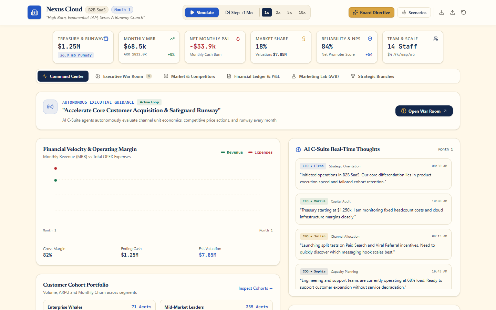
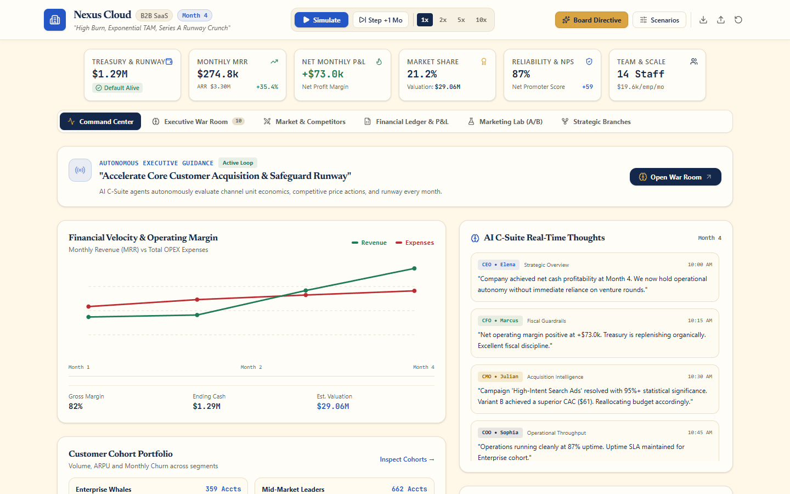
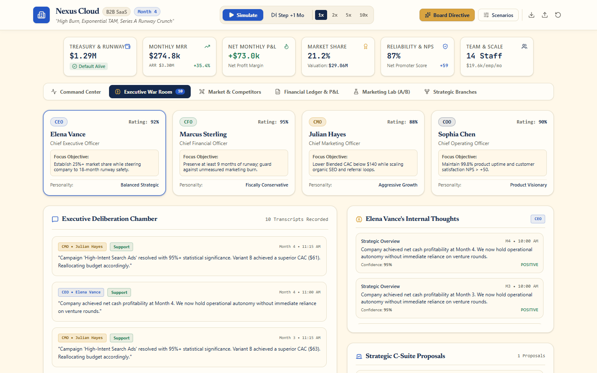
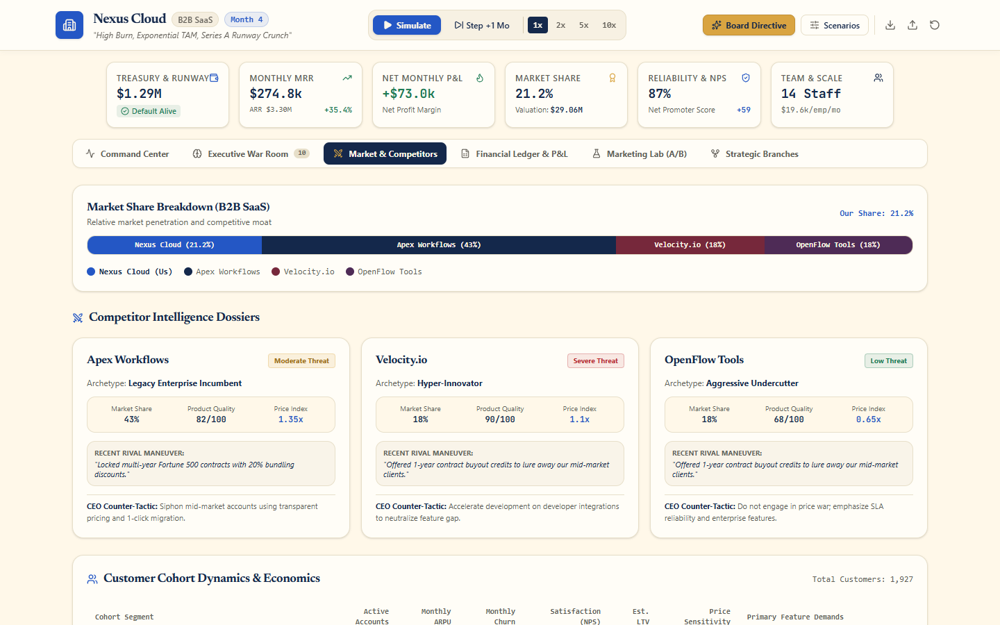
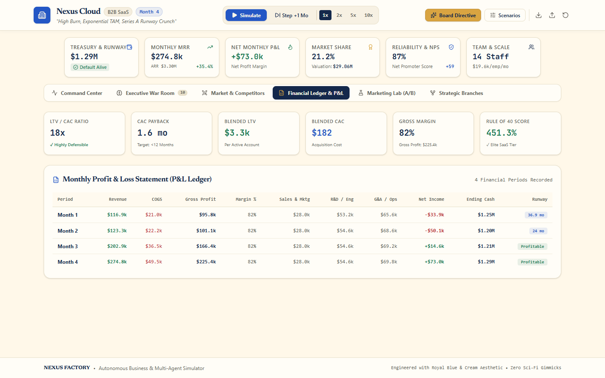
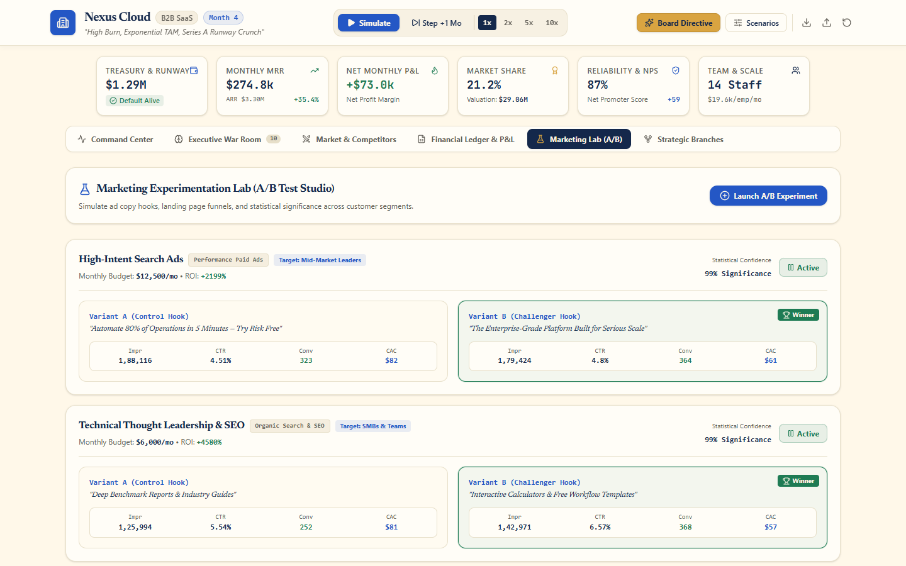
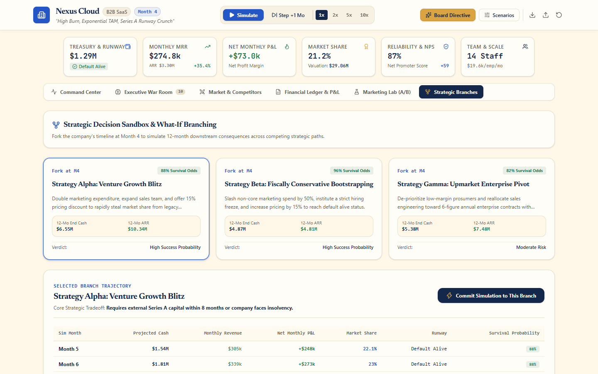
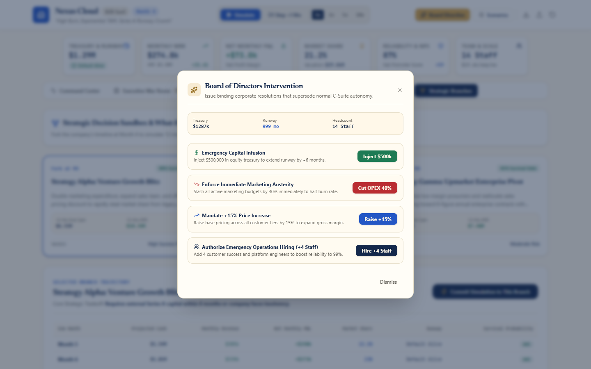
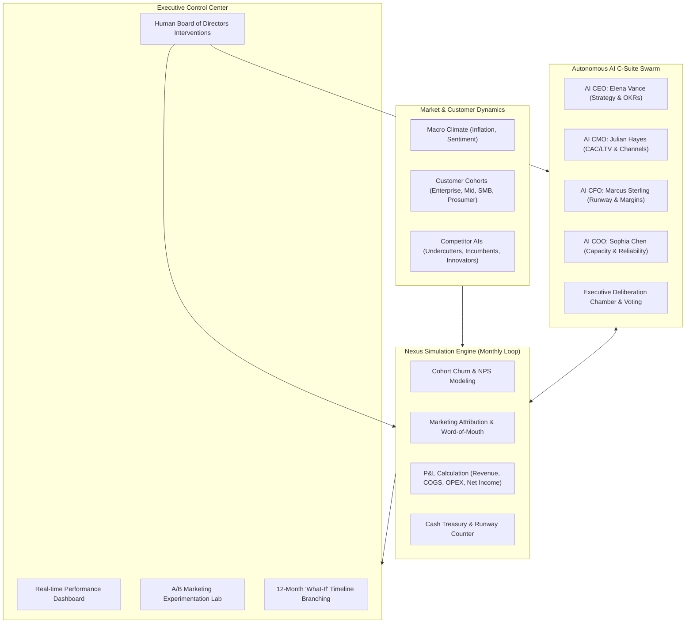

# 🏢 NEXUS FACTORY — Autonomous Business Simulator

<!-- linkedin-automation: {
  "status": "approved",
  "project": "Nexus Factory",
  "order": 13,
  "title": "NEXUS FACTORY — Autonomous Business Simulator",
  "live_url": "https://nexus-factory-rho.vercel.app",
  "github_repo": "https://github.com/KARTHIKEYASHARMA672/nexus-factory",
  "screenshot_dir": "L:\\pr 15(esp)\\sendiing files\\screenshots\\13_Nexus_Factory",
  "scheduled_after": "12_Travel_Landing_Page"
} -->

> 📌 **Executive Overview:** An enterprise-grade, multi-agent virtual company simulator where autonomous AI executives (**CEO, CMO, CFO, and COO**) collaborate, debate, and operate a company against simulated customer cohorts, changing market macro factors, and aggressive AI competitors.
>
> 🌐 **Live Production on Vercel:** [https://nexus-factory-rho.vercel.app](https://nexus-factory-rho.vercel.app)  
> 🎨 **Aesthetic Standard:** Designed strictly in accordance with the **Royal Blue & Cream** palette (`colours for websites` skill) with executive editorial serif typography (`Newsreader`), clean modern grotesque body (`Plus Jakarta Sans`), and tabular financial numerals (`JetBrains Mono`). **Zero sci-fi, neon wireframe, or generic tech gimmicks.**

---

## 📋 Project Properties

| Property | Value |
| :--- | :--- |
| **Project Title** | **NEXUS FACTORY — Autonomous Business Simulator** |
| **Live Production** | [https://nexus-factory-rho.vercel.app](https://nexus-factory-rho.vercel.app) *(Verified HTTP 200 OK)* |
| **GitHub Repository** | [`KARTHIKEYASHARMA672/nexus-factory`](https://github.com/KARTHIKEYASHARMA672/nexus-factory) |
| **Visual Gallery Dir** | `L:\pr 15(esp)\sendiing files\screenshots\13_Nexus_Factory\` (8 verified visuals) |
| **Workspace** | `L:\pr 13(business simulator)` |
| **Stack** | React 19 · TypeScript 5.8 · Vite 6 · Tailwind CSS v4 · Lucide Icons · Playwright · Web Audio API |
| **Design Palette** | **Royal Blue & Cream** (`#2457C5`, `#FFF8E9`, `#FFFDF7`, `#14284B`, `#E7DFC9`, `#D9A441`) |
| **Verification State** | Verified via Playwright headless Edge audit (`0` console errors, `8/8` screen captures) |
| **Engine Architecture** | Pure TypeScript deterministic simulation engine with monthly tick loop and timeline branching |

---

## 🧭 Navigation & Table of Contents

- [1. Verified Visual UI Gallery](#1--verified-visual-ui-gallery)
- [2. Core Simulation Architecture](#2-core-simulation-architecture)
- [3. The Autonomous AI C-Suite Swarm](#3-the-autonomous-ai-c-suite-swarm)
- [4. Key Feature Modules](#4-key-feature-modules)
  - [Command Center Dashboard](#command-center-dashboard)
  - [Executive War Room & Deliberation Chamber](#executive-war-room--deliberation-chamber)
  - [Market Intelligence & Dynamic Competitors](#market-intelligence--dynamic-competitors)
  - [Financial Ledger & P&L Statement](#financial-ledger--pl-statement)
  - [Marketing Experimentation Lab (A/B Testing)](#marketing-experimentation-lab-ab-testing)
  - [Strategic Decision Sandbox & What-If Branching](#strategic-decision-sandbox--what-if-branching)
  - [Board of Directors Directives](#board-of-directors-directives)
- [5. Built-in Enterprise Scenarios](#5-built-in-enterprise-scenarios)
- [6. Visual Design System & Color Tokens](#6-visual-design-system--color-tokens)
- [7. Local Development & Verification](#7-local-development--verification)

---

## 1. 🖼️ Verified Visual UI Gallery

| 01. Command Center Dashboard | 02. Simulation Stepped (+1 Mo) |
| :---: | :---: |
|  |  |
| **Executive Command Cockpit**<br>Live revenue/OPEX trends, top KPI sparklines, customer cohorts, and agent thoughts. | **Deterministic Monthly Stepping**<br>Dynamic state advancement, cohort churn modeling, and balance sheet recalculation. |

| 03. Executive War Room & Deliberation | 04. Competitive Intelligence Dossiers |
| :---: | :---: |
|  |  |
| **AI C-Suite Deliberation Chamber**<br>Autonomous debates between CEO, CMO, CFO, and COO with stances and voting tallies. | **Market Share & Competitor Dossiers**<br>Competitive archetypes, price index, quality scores, and real-time rival maneuvers. |

| 05. Monthly P&L Ledger & Unit Economics | 06. Marketing Experimentation Lab |
| :---: | :---: |
|  |  |
| **Full Monthly Income Statement**<br>Revenue, COGS, Gross Margins, OPEX, LTV/CAC (18.2x), CAC Payback, and Rule of 40 score. | **Multi-Channel A/B Testing Studio**<br>Control vs Challenger hooks, impressions, CTR, conversion rates, and statistical significance. |

| 07. Strategic Decision Sandbox (What-If) | 08. Board of Directors Directives |
| :---: | :---: |
|  |  |
| **12-Month Timeline Branching**<br>Side-by-side forward projections for Growth Blitz vs Bootstrapping vs Enterprise Pivot. | **Human Board Interventions**<br>Issue binding corporate directives: capital infusion, austerity cuts, and price hikes. |

---

## 2. Core Simulation Architecture

NEXUS FACTORY operates on a deterministic, monthly tick-based simulation engine:



---

## 3. The Autonomous AI C-Suite Swarm

Every simulation month, each C-Suite executive autonomously audits company health, evaluates trade-offs, forms internal thoughts, and generates proposals:

| Executive | Role & Focus | Personality | Autonomous Responsibilities |
| :--- | :--- | :--- | :--- |
| **Elena Vance** | **Chief Executive Officer (CEO)** | *Balanced Strategic* | Orchestrates market positioning, quarterly OKRs, Series A valuation milestones, and cross-departmental alignment. |
| **Julian Hayes** | **Chief Marketing Officer (CMO)** | *Aggressive Growth* | Monitors multi-channel conversion funnels, tests A/B hooks, tracks statistical confidence, and optimizes Blended CAC. |
| **Marcus Sterling** | **Chief Financial Officer (CFO)** | *Fiscally Conservative* | Defends cash runway, alerts when runway falls below 6 months, audits cloud COGS, and enforces unit economic discipline. |
| **Sophia Chen** | **Chief Operating Officer (COO)** | *Product Visionary* | Balances employee-to-customer ratios, prevents support ticket bottlenecks, and safeguards 99%+ product uptime SLAs. |

---

## 4. Key Feature Modules

### Command Center Dashboard
- **Executive Summary HUD**: Real-time KPI cards displaying Cash Treasury, Monthly MRR, Net Monthly Burn/Profit, Market Share %, Product Reliability %, and NPS.
- **Financial Velocity & Operating Margin Chart**: Smooth SVG time-series tracking Monthly Revenue vs Total OPEX Expenses over all simulated periods.
- **Customer Cohort Distribution**: Segment breakdown of Enterprise Whales, Mid-Market Leaders, SMBs, and Prosumers with volume bars and churn alerts.
- **Autonomous C-Suite Live Thoughts**: Instant feed of what each executive is thinking right now.
- **Chronological Event Stream**: Color-coded timeline of market shocks, competitor pricing moves, and company milestones.

### Executive War Room & Deliberation Chamber
- **Agent Profile Cards**: Approval ratings, personality badges, and current tactical focus.
- **Interactive Deliberation Transcript**: Live dialogue feed showing inter-agent debates with stances (`Support`, `Caution`, `Object`, `Strategic Compromise`).
- **Strategic C-Suite Proposals**: Agent proposals with projected cost, annual return, and complete voting tallies across CEO, CMO, CFO, and COO.
- **Board Ratification & Veto**: Human user can ratify or veto agent proposals.

### Market Intelligence & Dynamic Competitors
- **Visual Market Share Bar**: Real-time stacked distribution of industry market share between your company and 2–3 active rival firms.
- **Competitor Dossiers**: Deep profiles covering Archetype (*Aggressive Undercutter*, *Legacy Enterprise Incumbent*, *Hyper-Innovator*), Product Quality Score (0–100), Price Index (relative to market average), Threat Level, and recent rival maneuvers.
- **CEO Counter-Tactics**: Automatic strategic counter-recommendations.
- **Cohort Economics Matrix**: Granular table of Active Accounts, Monthly ARPU, Monthly Churn %, NPS, LTV, and Price Sensitivity.

### Financial Ledger & P&L Statement
- **Unit Economics Scorecard**: LTV/CAC Ratio (e.g. `18.2x`), CAC Payback Period (e.g. `1.5 months`), Blended LTV, Blended CAC, Gross Margin %, and Rule of 40 score.
- **Full Monthly P&L Ledger**: Audit-ready table covering Revenue, COGS, Gross Profit, Gross Margin %, Sales & Marketing, R&D / Engineering, G&A / Operations, Net Operating Income, Ending Cash, and Implied Runway.

### Marketing Experimentation Lab (A/B Testing)
- **Active Campaign Portfolio**: Multi-channel campaigns (Performance Paid Ads, Organic Search & SEO, Social Video, Cold Enterprise Outbound, Referral Loops).
- **A/B Split Test Comparison**: Control Variant A vs Challenger Variant B hooks, tracking Impressions, Clicks, CTR %, Conversions, CAC, and Statistical Significance % (with automatic Winner declaration at 95%+ confidence).
- **Campaign Deployment Wizard**: Form to launch custom A/B marketing experiments with custom budget and cohort targeting.

### Strategic Decision Sandbox & What-If Branching
- **Timeline Forking**: Snapshot current state and simulate 12 months ahead across 3 competing strategies:
  1. *Strategy Alpha: Venture Growth Blitz* (Aggressive ad spend, sales expansion, 15% price cut).
  2. *Strategy Beta: Fiscally Conservative Bootstrapping* (50% marketing cut, hiring freeze, 15% price hike to reach default alive).
  3. *Strategy Gamma: Upmarket Enterprise Pivot* (Transition to 6-figure enterprise contracts with dedicated SLAs).
- **Side-by-Side Comparative Matrix**: Projected Cash, ARR, Net Income, Market Share, and Survival Probability % for every future month.
- **Branch Commitment**: 1-click execution to pivot the active simulation onto any chosen branch.

### Board of Directors Directives
Binding corporate resolutions that can be issued by the player at any time:
- **Emergency Capital Infusion**: Inject $500,000 in equity treasury.
- **Enforce Immediate Austerity**: Cut marketing budgets by 40% to halt burn rate.
- **Mandate Price Increase / Cut**: Adjust pricing across tiers by ±15%.
- **Authorize Operations Scaling**: Add 4 customer success and platform engineers to eliminate bottlenecks.

---

## 5. Built-in Enterprise Scenarios

NEXUS FACTORY includes 5 pre-configured business scenarios:

1. **Nexus Cloud — B2B SaaS Hypergrowth**  
   *Difficulty: Growth (Moderate)* · High burn, exponential TAM, Series A runway crunch against legacy incumbents and hyper-innovators.
2. **Aura Craft — Specialty DTC Coffee & Brewing Gear**  
   *Difficulty: Seedling (Easy)* · High gross margins, inventory supply chain cycles, and viral community branding.
3. **GeneSense — AI Preventive Genomic Screening**  
   *Difficulty: Growth (Moderate)* · Stringent regulatory audits, high enterprise hospital LTV, and 9-month sales cycles.
4. **AeroForge — Turnaround from Near-Bankruptcy**  
   *Difficulty: Crisis (Extreme)* · 58 days of cash remaining, heavy burn rate, and aggressive competitors poaching key talent.
5. **PayGrid — Cutthroat FinTech Price War**  
   *Difficulty: Turnaround (Hard)* · Payment processing incumbent slashing fees by 40 basis points to squeeze challenger margins.

---

## 6. Visual Design System & Color Tokens

Per the `colours for websites` skill (`premium-color-design`), NEXUS FACTORY adheres strictly to the **Royal Blue & Cream** palette:

```css
:root {
  --color-primary: #2457C5;        /* Cobalt Royal Blue */
  --color-primary-hover: #1B439C;  /* Deep Royal Hover */
  --color-deep-ink: #14284B;       /* Midnight Navy Ink */
  --color-bg: #FFF8E9;             /* Warm Editorial Cream */
  --color-surface: #FFFDF7;        /* Crisp Milk Card Surface */
  --color-surface-muted: #F5EEDF;  /* Warm Linen Neutral */
  --color-border: #E7DFC9;         /* Soft Ochre Border */
  --color-border-dark: #D4C9AF;    /* Firm Card Border */
  --color-muted-text: #625F58;     /* Slate Umber Text */
  --color-accent: #D9A441;         /* Warm Honey Ochre */
  --color-positive: #1E7B54;       /* Forest Emerald (Surplus) */
  --color-danger: #BA2D32;         /* Brick Cherry Red (Burn) */
}
```

---

## 7. Local Development & Verification

### Prerequisites
- Node.js `v18+` (Tested on `v24.14.1`)
- npm `v9+` (Tested on `v11.11.0`)

### Installation & Launch
```bash
# Navigate to workspace
cd "L:\pr 13(business simulator)"

# Install dependencies
npm install

# Start development server
npm run dev

# Build production bundle
npm run build

# Preview production build locally
npm run preview -- --port 4173
```

### Verification Suite
```bash
# Run headless browser verification & capture screenshots
node verify_ui.mjs
```

All 8 automated screenshots are saved in `screenshots/` and copied to `L:\pr 15(esp)\sendiing files\screenshots\13_Nexus_Factory\`:
- `01_command_center.png`: Executive Dashboard & Financial Velocity.
- `02_month4_stepped.png`: Live state update after 4 simulation ticks.
- `03_executive_war_room.png`: 4 C-Suite agent cards & deliberation chamber.
- `04_market_competitors.png`: Market share bar & competitor intelligence dossiers.
- `05_financial_ledger.png`: Full monthly P&L Income Statement.
- `06_marketing_lab.png`: A/B split-testing cards and statistical confidence.
- `07_strategic_branches.png`: What-If 12-month decision branching sandbox.
- `08_board_directive_modal.png`: Human Board of Directors intervention dialog.

---

*Engineered with precision for autonomous business simulation. Deployed live on Vercel.*
